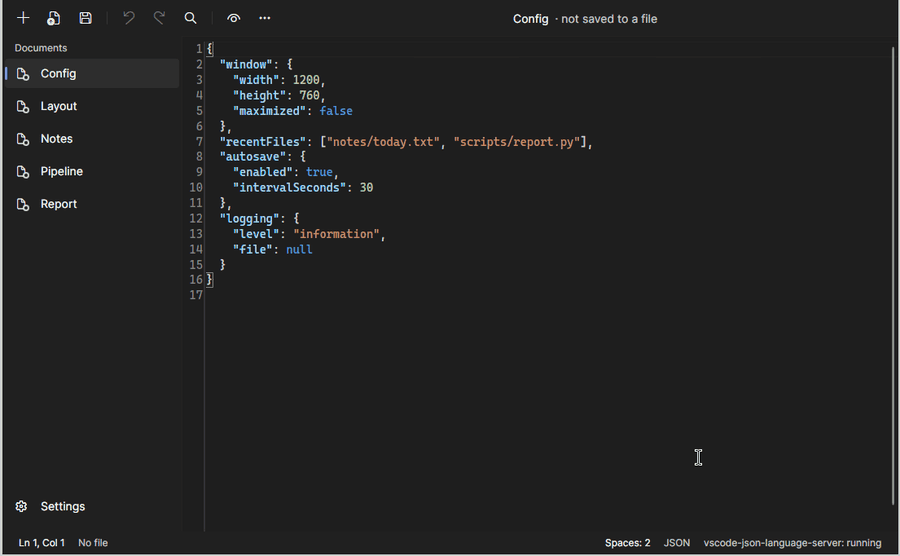

# Darp.CodeEditor

[](https://www.nuget.org/packages/Darp.CodeEditor)
[](https://github.com/rosslight/Darp.CodeEditor/actions/workflows/build-test.yml)
[](https://github.com/rosslight/Darp.CodeEditor/blob/main/LICENSE)

A code editor control for Avalonia desktop apps, with syntax highlighting, search, and completion, hover and
diagnostics from any language server.

Selected language servers will ship as NuGet packages. C# scripting comes first: your app defines what scripts can
see, and the package brings the language server and a runner that executes scripts in a separate process.



> **Status:** 0.x. The editor works today, and its API may still change. The C# scripting packages ship with the next
> release.

## Quickstart

Requires .NET 10 and Avalonia 12.1.5 or later.

```sh
dotnet add package Darp.CodeEditor
```

Add the editor's styles once, after your app's theme:

```xml
<!-- App.axaml -->
<Application xmlns:ce="using:Darp.CodeEditor" ...>
  <Application.Styles>
    <FluentTheme />
    <ce:CodeEditorStyles />
  </Application.Styles>
</Application>
```

Place the editor in a view:

```xml
<!-- MainWindow.axaml -->
<Window xmlns:ce="using:Darp.CodeEditor" ...>
  <ce:CodeEditor Name="Editor" />
</Window>
```

Give it a document. Your app owns the document and disposes it:

```csharp
// MainWindow.axaml.cs
using Darp.CodeEditor;

public partial class MainWindow : Window
{
    private readonly CodeDocument _document = CodeDocument.Create(CodeLanguage.Json, """{ "hello": "world" }""");

    public MainWindow()
    {
        InitializeComponent();
        Editor.Document = _document;
        Closed += (_, _) => _document.Dispose();
    }
}
```

More information: [Getting started](https://rosslight.github.io/Darp.CodeEditor/) and
[Documents and editors](https://rosslight.github.io/Darp.CodeEditor/documents/).

## Packages

| Package | What it adds | Status |
|---|---|---|
| [`Darp.CodeEditor`](https://www.nuget.org/packages/Darp.CodeEditor) | The editor, JSON, XML and YAML, and a client for any language server | Available |
| `Darp.CodeEditor.CSharpScript` | C# scripts with an environment your app defines: language server and compilation | Next release |
| `Darp.CodeEditor.CSharpScript.Runner` | Runs scripts in a separate process, with a typed bridge to your app | Next release |

## Features

- **Highlighting:** TextMate grammars and VS Code color themes, with Light+ and Dark+ following your app's theme.
- **Language servers:** completion, signature help, hover and diagnostics. The UI never waits for a server.
- **Editing:** auto-indent, bracket matching, auto-closing pairs, comment toggling, rectangle selection and line commands.
- **Search:** plain-text find and replace, with Match Case and Match Whole Word, running in the background.
- **Documents:** undo history per document, and several editors can show the same document.
- **NativeAOT:** the editor works in trimmed, ahead-of-time compiled apps.

Darp.CodeEditor is a light editor for scripts and small files, not an IDE. Rename, quick fixes, refactorings, find
usages and formatting are out of scope for v1.

More information: [What the editor covers](https://rosslight.github.io/Darp.CodeEditor/#what-the-editor-covers) and
[Customizing](https://rosslight.github.io/Darp.CodeEditor/customizing/).

## Connect a language server

Any server that speaks the Language Server Protocol over stdio works. For JSON, install one with
`npm install -g vscode-langservers-extracted`, then let the server create the document:

```csharp
var server = new LanguageServer(new LanguageServerOptions
{
    FileName = "vscode-json-language-server",
    Arguments = ["--stdio"],
});

CodeDocument document = server.CreateDocument(CodeLanguage.Json, text, filePath);
Editor.Document = document;
```

The process starts with the first document and restarts after a crash. Dispose each document when the user closes it,
and the server when your app exits.

For another language, create a `CodeLanguage` from a VS Code extension's grammar and language configuration.

More information: [Language servers](https://rosslight.github.io/Darp.CodeEditor/language-servers/) and
[Languages](https://rosslight.github.io/Darp.CodeEditor/languages/).

## C# scripting

Your app defines the globals, references and imports a script sees. The editor checks scripts against that same
definition, the C# server compiles them, and a runner executes them in a separate process, with a typed bridge back to
your app. It works in JIT and NativeAOT apps:

```csharp
var environment = new CSharpScriptEnvironment<Globals>();
CSharpScriptDocument<Globals> document = server.CreateDocument(environment, """await AskAsync("Continue?");""");
Editor.Document = document;

CSharpScriptCompilation<Globals> compilation = await document.CompileAsync(stop);
if (compilation.Script is { } script)
{
    await using var session = await CSharpScriptSession.StartAsync<IAppSide, ISessionSide, Session>(new AppSide(), stop);
    CSharpScriptRun run = await session.StartScriptAsync(script, new RunInput("first"), stop);
    await run.RunToEndAsync(stop, killSessionAfter: TimeSpan.FromSeconds(2));
}
```

More information: [C# scripts](https://rosslight.github.io/Darp.CodeEditor/csharp-scripts/).

## Learn more

- **[Documentation](https://rosslight.github.io/Darp.CodeEditor/):** focused guides for people and AI agents, with an
  [`llms.txt`](https://rosslight.github.io/Darp.CodeEditor/llms.txt) index.
- **[Sample app](https://github.com/rosslight/Darp.CodeEditor/tree/main/samples/Darp.CodeEditor.Sample):** documents,
  files, language servers, themes and NativeAOT publishing in one app.
- **API documentation:** every public member is documented, and shows up in your IDE.
- **[Design](https://github.com/rosslight/Darp.CodeEditor/blob/main/design/design.md):** goals, performance budgets and
  decisions.
- **AI agents:** the `Darp.CodeEditor` package includes a skill at `skills/darp-codeeditor/SKILL.md`. After a restore,
  find it in your NuGet packages folder under `darp.codeeditor/<version>/`.

## Contributing and license

See [CONTRIBUTING.md](https://github.com/rosslight/Darp.CodeEditor/blob/main/CONTRIBUTING.md) to build and test the
project. Darp.CodeEditor is licensed under
[Apache 2.0](https://github.com/rosslight/Darp.CodeEditor/blob/main/LICENSE) and is a project by
[rosslight GmbH](https://engineering.rosslight.de/).
