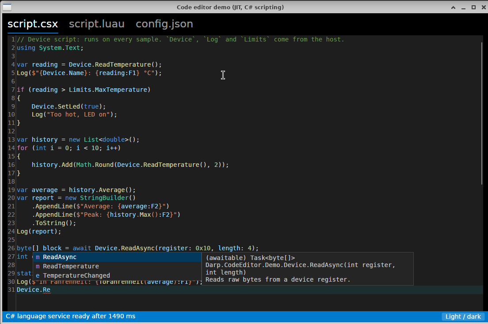
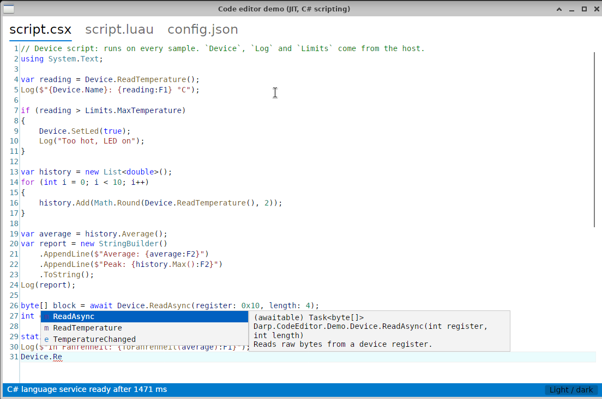
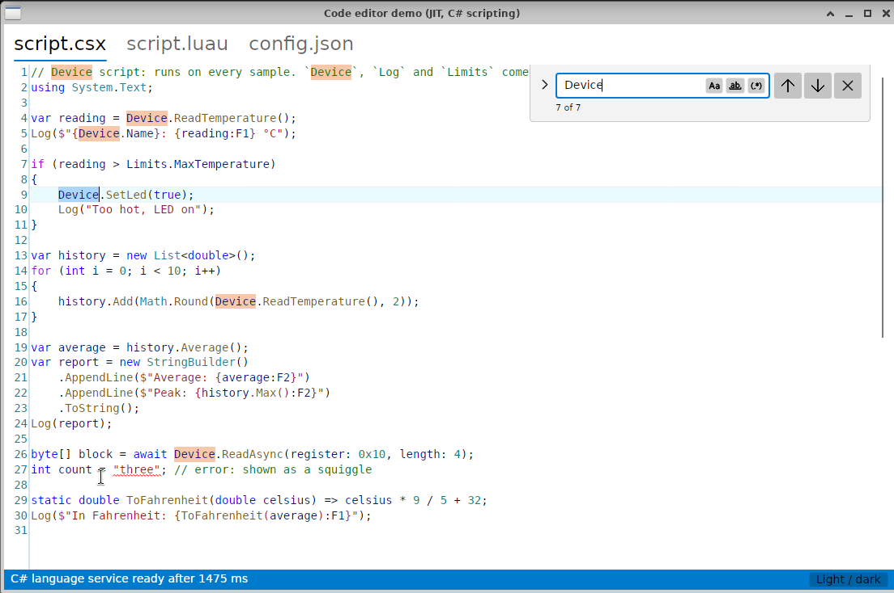
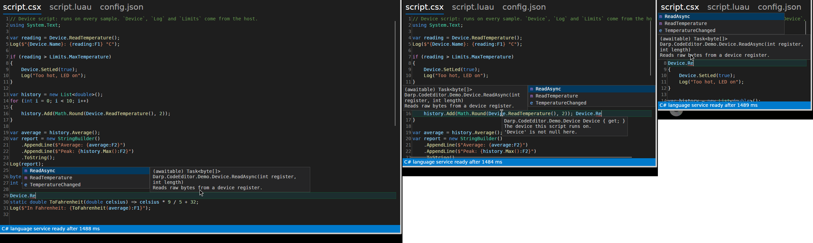

# Editor polish: measurements

Status: Linux x64 VM measured (2026-11-02/03). Windows numbers are still to come: run `tools/measure/run-windows.ps1`
on the Windows laptop.

What changed, one commit each on `feat/editor-polish`: completion, signature help and hover draw inside the window;
the first completion list no longer stalls; visible lines get colors in the frame that shows them; light and dark VS
Code themes follow the app; editing helpers; the key-to-pixel probe.

## How

Linux x64 VM (8 vCPU of an i7-13700, no GPU), Xvnc 1600×900 with xfwm4, .NET 10.0.13/10.0.14, the same display for
both runs. The machine is shared with other agents: load average 0.3–1.7 during the baseline and 2.0–3.1 during the
"after" run, so the numbers are indicative.

- **Before**: `main` at the probe commit (native popups, the demos' default; `--overlay-popups` reported separately).
- **After**: the branch before review fixes; the fixes do not touch the measured paths, except the grammar lock, which
  was re-measured for opening and scrolling (marked ¹).
- `tools/measure/run-linux.sh`: `--bench` of both demos, highlighted text on screen after launch (median of 5), and key
  to changed pixels (60 samples each way). Raw output: `measurements/` (git-ignored).

## Results

| | Before | After |
|---|---|---|
| **Keystroke handling p99**, C# completion sessions (JIT) | 31.7 ms (native popups); 2.7 ms in-window | **2.4 ms** |
| Keystroke handling p99, typing burst with C# completion (JIT) | 32.7 ms, max 48.5 ms | **1.6 ms**, max 5.6 ms |
| UI stalls over 16 ms during C# completion / typing burst (JIT) | 99 / 108 | **0 / 0** |
| Keystroke handling p99, JSON typing burst with completion (AOT) | 27.4 ms, 14 stalls over 16 ms | **3.7 ms**, 0 stalls |
| **First completion: UI stall** (JIT) | 29 ms in-window, 41 ms native; `completion-ui` 28 ms | **none over 16 ms** (max 11 ms); `completion-ui` ≤ 7 ms |
| Popup open (`completion-ui`, p50) | 1–2 ms | 0–1 ms |
| First / warm completion latency (Roslyn, word list p50/p95) | 139 ms / 16 / 30 ms | 119 ms / 12 / 36 ms |
| **Lines without colors on the first frame** (JIT startup) | all, for ~100 ms (text 728, colors 827 ms) | **0** (text 676, colors 681 ms) |
| Lines without colors on the first frame, AOT startup | all, for ~14 ms | 21 of 21 for 1–3 frames (see open issues) |
| Opening a 10k-line file in a new editor | colored after 36 ms | **0 uncolored lines on the first frame**, 10–15 ms ¹ |
| Scrolling a page per frame: frames with uncolored lines | 1 of 251 | 0 and 5 of 251 (two runs, load 4) ¹ |
| 20k-character line: worst UI stall, keystroke max (JIT) | 2.4 ms, 2.5 ms | 2.5 ms, 3.3 ms |
| Highlighted text on screen after launch, AOT / JIT (median) | 98 / 861 ms | 99 / 861 ms |
| UI thread work for the theme at editor creation, JIT / AOT | 39 / 11 ms | **0** (applying a theme ≤ 1 ms) |
| Theme switch light ↔ dark, AOT (first, then later) | – | 30 ms, then 1–3 ms; 0 uncolored lines |
| Theme switch light ↔ dark, JIT (first, then later) | – | 84 ms, then 3–5 ms; 0 uncolored lines |
| **Key to changed pixels**, AOT p50 / p95 / p99 (type 'm') | 15.9 / 24.1 / 33.3 ms | 15.2 / 22.6 / 24.1 ms |
| Key to changed pixels, JIT p50 / p95 / p99 (type 'm') | 14.7 / 22.9 / 26.1 ms | 16.2 / 23.8 / 26.3 ms |
| NativeAOT trim/AOT warnings | 0 | 0 |

Notes:

- Key to changed pixels is dominated by frame pacing on this VM (Xvnc, software rendering); the typing path was already
  sub-millisecond. It is the number to compare on Windows.
- On screen, the probe's "editor text" time is not meaningful on this VM: without a compositor the root window still
  shows the previous run's pixels when the new window maps, so it reports text 2 ms after the window. Highlighted text is
  reported instead. In JIT it is bounded by the first frame the app presents (~850 ms), not by highlighting.
- The first completion's remaining cost was JIT compilation: the AOT demo's first list took ≤ 8 ms already. The list is
  now warmed up while the UI is idle, in dispatcher jobs of 2–5 ms each.

## Screenshots

| Dark | Light |
|---|---|
|  |  |

Completion placement in a wide, a narrow and a small window: the description beside the list, on the left when the
right has no room, and stacked above the line when neither side has room.

## Open issues

- **AOT startup frame.** The AOT demo shows its first frame about 8 ms after the grammars start loading; a cold grammar
  from a file needs 13–20 ms (registry, theme, grammar, first screen), so the first 1–3 frames of an AOT app have no
  colors. Everything after that, and every JIT start measured here, colors the frame that shows the lines. A host could
  preload grammars before creating its window; there is no API for that yet.
- **JIT idle stalls after startup.** In the JIT demo, the first ~100 ms after the first frame have three UI stalls of
  35–55 ms (one with an 8 ms gen2 GC), against two in the baseline; none in AOT, so it is first-use JIT compilation.
  Not attributed yet; a trace would tell.
- **First variant switch in JIT.** Switching the app between light and dark the first time stalls ~50 ms while Avalonia
  restyles the window (JIT); the editor's own part is ≤ 1 ms. AOT: no stall over 4 ms.
- **The 4 ms budget is cooperative.** TextMate checks its time limit between regex searches, so one expensive
  expression can overrun it. A grammar that overran by more than the budget once is tokenized only on the thread pool
  from then on.
- **Probe on X11.** Before each key the probe checks the active window and the input focus; a keyboard grab by another
  client is not detected, and check and injection are not atomic on either platform. Do not use the machine while it
  runs.
