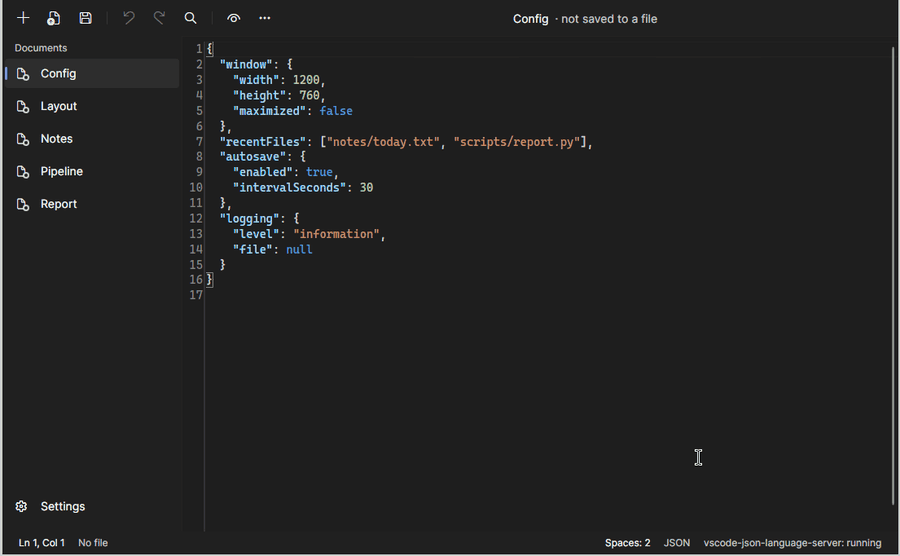

# Getting started

Darp.CodeEditor is a code editor control for Avalonia desktop apps. It brings syntax highlighting, search, and
completion, hover and diagnostics from language servers. This page takes you from an empty Avalonia app to a working
editor.



!!! info "Status"

    The project is at 0.x. The editor works today, and its API may still change.

## Install the package

The package needs .NET 10 and Avalonia 12.1.5 or later.

```sh
dotnet add package Darp.CodeEditor
```

## Add the styles

Add the editor's styles once, after your app's theme:

```xml
<!-- App.axaml -->
<Application xmlns:ce="using:Darp.CodeEditor" ...>
  <Application.Styles>
    <FluentTheme />
    <ce:CodeEditorStyles />
  </Application.Styles>
</Application>
```

## Place the editor

```xml
<!-- MainWindow.axaml -->
<Window xmlns:ce="using:Darp.CodeEditor" ...>
  <ce:CodeEditor Name="editor" />
</Window>
```

## Show a document

The editor shows a `CodeDocument`, which your app creates, owns and disposes. Add `using Darp.CodeEditor;` to
`MainWindow.axaml.cs`, and this code to its constructor after `InitializeComponent()`:

```csharp
--8<-- "first-editor.cs:document"
```

To run this as a complete app from a clone of the repository:

```sh
dotnet run samples/docs/first-editor.cs
```

## What the editor covers

The editor is meant for scripts and small files.

| Area | Included |
|---|---|
| Highlighting | TextMate grammars and VS Code color themes |
| Language servers | Completion, signature help, hover, diagnostics, semantic colors and occurrences |
| Editing | Auto-indent, bracket matching, auto-closing pairs, comment toggling, rectangle selection and line commands |
| Search | Plain-text find and replace, with Match Case and Match Whole Word |
| Documents | Undo history per document, and several editors on one document |

Rename, quick fixes, refactorings, find usages and formatting are out of scope for v1. Search has no regular expressions.

## NativeAOT

The editor works in trimmed, ahead-of-time compiled apps, with no extra setting. Ship your own grammars and themes as
`AvaloniaResource` items, so the app needs no loose files:

```sh
dotnet publish -c Release -r linux-x64 -p:PublishAot=true
```

## Where to next

- [Documents and editors](documents.md): ownership, saving, tabs and threads.
- [Languages](languages.md): the built-in languages, and adding your own.
- [Language servers](language-servers.md): completion, hover and diagnostics.
- [Customizing](customizing.md): colors, keys, commands and search.

AI agents can start from [`llms.txt`](llms.txt), or read one file with all guides in
[`llms-full.txt`](llms-full.txt). The NuGet package also includes a skill at `skills/darp-codeeditor/SKILL.md`, and XML
documentation for the installed version.

## Rules

- Add `CodeEditorStyles` once, after the app's theme.
- Create editors on the UI thread, so not in the constructor of your `Application` class.
- Dispose every document, also one without a language server.
