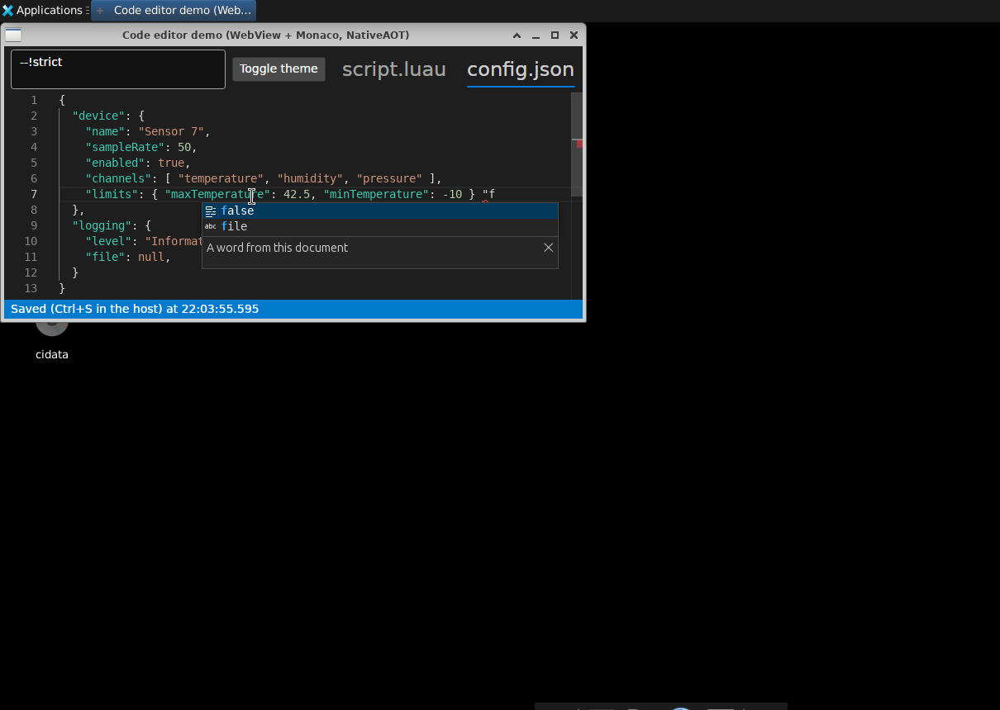
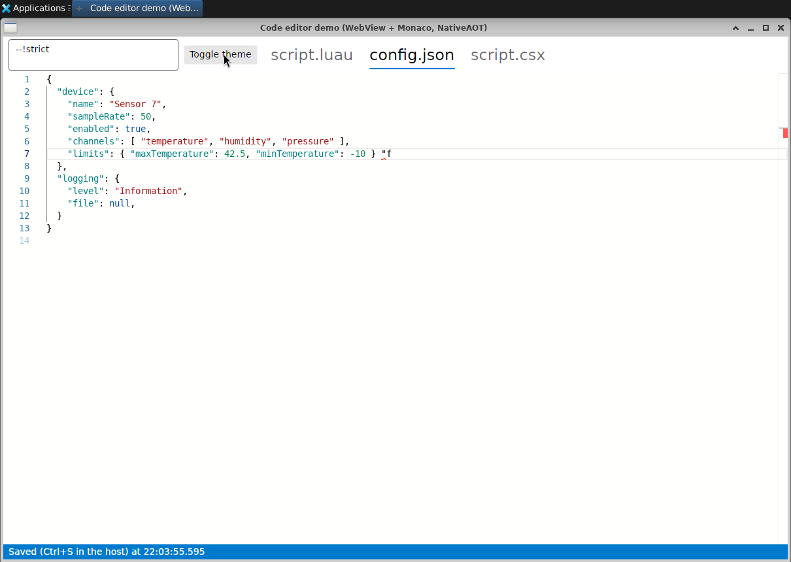

# Editor surface bake-off: own editor vs WebView (Monaco, CodeMirror 6)

Status: Linux x64 measured (2026-11-02). Windows numbers are still to come; see [Windows](#windows).

- **A** is this repository's editor: AvaloniaEdit, background TextMate highlighting, `ILanguageService` in-process.
- **B** is Avalonia's official `NativeWebView` (Avalonia.Controls.WebView 12.1.1, MIT) running a browser editor, in two
  variants: **Monaco 0.57** (ESM) and **CodeMirror 6** (latest packages). Both run their LSP client in the page; the host
  only relays JSON-RPC to an LSP adapter over the same `ILanguageService`.

## Result

**Recommendation: keep A.** On this machine only A meets the startup budget. It also uses a sixth to a ninth of the
memory and integrates as an ordinary Avalonia control. B works and types without visible lag, but it is slower to show
text, to complete and to start, and on Linux it needed three workarounds just to behave. If B is chosen anyway,
**CodeMirror** beats Monaco on startup, memory, long lines and completion; Monaco is better at keeping a scrolled
10k-line file colored.

What decides it, and what does not:

- **Startup.** Highlighted text on screen, seen from outside, from launching the process (AOT hosts, no C#):
  A **102 ms**, CodeMirror **293 ms**, Monaco **544 ms**. B's floor is the web view itself: the GTK web view exists at
  ~133 ms, the page script runs at 272 ms (CodeMirror, 0.5 MB) or 446 ms (Monaco, 4 MB), and until then the editor area
  is a light-gray rectangle. Software GL and the VM make every number here slower than on real hardware, for both
  sides, but the web engine's process start and page load are inherent to B. Windows (WebView2) still has to show
  whether B gets near the budget.
- **Typing.** No visible lag anywhere. Keystroke to changed pixels (XTest → X framebuffer, p50): A 15 ms,
  CodeMirror 17–18 ms, Monaco 21–22 ms, all within about one 60 Hz frame of each other. These numbers are mostly frame
  pacing on this VM: with WebKit's compositing off, CodeMirror drops to 5 ms and Monaco to 12 ms.
- **Completion.** Warm word list (~3k items, Roslyn, p50): A 10–16 ms, CodeMirror 33–35 ms, Monaco 40 ms. Member list:
  A 5–7 ms, CodeMirror 8–9 ms, Monaco 15–17 ms. All are far below what users notice. B's extra time is the 645–890 KB
  JSON list crossing into the page and being parsed there; an out-of-process C# server would add part of that
  serialization to A as well.
- **UI thread.** B's Avalonia UI thread stays free during editing (max 15 ms in every scenario); one 77–82 ms stall
  comes from the WebView library creating the GTK web view synchronously at startup. B's page main thread reaches
  39–43 ms (Monaco on the 20k-character line, completion lists).
- **Memory** (PSS summed over all processes, AOT, after the benchmarks): A 132 MB, CodeMirror 853 MB, Monaco 1208 MB.
  WebKit runs one web process per editor (200–430 MB each here). Software GL inflates this; a GPU would move part of
  it out of process memory.
- **Integration.** On Linux/X11, B needed workarounds for a hidden first editor, keystrokes lost whenever the pointer was
  over the Avalonia part of the window, and Monaco's broken paste from other applications. Still open: the process
  sometimes crashes when the window closes while a page loads, and aborts at exit after a web view was removed (both
  inside Avalonia's WebView); DPI scaling does not follow Avalonia's; a gray flash at startup; Tab never leaves or enters
  the web view; editor popups cannot extend past it; host shortcuts must be forwarded from the page. See the
  [checklist](#integration-checklist).
- **Code we would own.** B's UI code is smaller: about 410 lines of host C# plus 270 (Monaco) or 400 (CodeMirror)
  lines of page code, against A's 1,430 editor lines. B also gets folding, multiple cursors, find and replace, and a
  ready LSP client for luau-lsp. A would need a C# LSP client to use luau-lsp (not built; an estimate is the size of the
  server adapter, 600–800 lines).
- Both publish with NativeAOT with **0 trim/AOT warnings**. Deploy size without symbols: A 48.1 MB, B 41.0 MB with both
  editors (36 MB with CodeMirror only), plus the system web engine: WebKitGTK 4.1 and JavaScriptCore take about
  127 MB on Linux and are not installed everywhere; WebView2 is part of Windows 11.

### Comparison

Linux x64 VM (8 vCPU of an i7-13700, no GPU), Xvnc 1600×900 with xfwm4, Ubuntu 26.04, .NET 10.0.13/10.0.14,
WebKitGTK 2.52.6. A and B ran one after the other on the same display in one session (2026-11-02); A was re-run, not
copied. Medians of 5 runs for startup; one benchmark run per app, repeated for B (and for A JIT) where noted. Raw
output: `measurements/bakeoff*` (git-ignored; regenerate with `tools/bakeoff/run-linux.sh`).

| | A: AvaloniaEdit | B: Monaco 0.57 | B: CodeMirror 6 | How |
|---|---|---|---|---|
| Highlighted text **on screen**, AOT | **102 ms** | 544 ms | 293 ms | Probe launches the app and polls the first editor lines on screen until they show two hues |
| Highlighted text on screen, JIT with C# | 878 ms | 1157 ms | 878 ms | Same |
| In-process: text visible / highlighted, AOT | 83 / 99 ms | 535 / 535 ms | 291 / 291 ms | A: visual lines built; B: DOM lines (MutationObserver); both right before the paint, ms after process start |
| In-process B, AOT: window, web view created, page script | – | 59, 133, 446 ms | 62, 134, 272 ms | |
| C# service ready / semantic colors / diagnostics, JIT | 2011 / 2141 / 2128 ms | 1755 / 2283 / 2238 ms | 1735 / 1983 / 2051 ms | Same Roslyn service; B: after the next paint |
| Keystroke handling, typing burst, no language server, p50 / p99 | 0.26 / 0.43 ms | 1 / 3 ms (mean 1.3) | 1 / 2 ms (mean 0.8) | Synchronous handling of one typed character in the editor's process. **Not equal**: B's page clock ticks in whole ms |
| Keystroke handling, typing burst with C# completion, p50 / p99 | 0.35 / 33 ms (native popups); 0.36 / 1.7 ms with `--overlay-popups` | 2 / 4 ms (mean 1.9) | 2 / 9 ms (mean 2.7) | Same |
| Keystroke → after the next paint (page only), p50 / p99 | – | 13 / 22 ms | 11 / 19 ms | Typed character to the first task after the next animation frame |
| **Keystroke → changed pixels on screen**, p50 / p95 | **15 / 22 ms** | 21–22 / 28–29 ms | 17–18 / 23–24 ms | XTest key into the window, poll the glyph's cell in the X framebuffer; 60 samples × 2 runs, 0 timeouts |
| Same, WebKit compositing off (`WEBKIT_DISABLE_COMPOSITING_MODE=1`) | – | 12 / 14–16 ms | 5 / 6 ms | |
| First completion (word list) | 150 ms (3282 items) | 207–220 ms (2925 items) | 160–178 ms (2925 items) | Triggering keystroke → list in the DOM / popup shown |
| Warm completion, word list, p50 / p95 | 10–16 / 25–35 ms | 40 / 58 ms | 33–35 / 49–57 ms | 19 sessions after 2 warm-up sessions |
| Warm completion, member list (9 items), p50 / p95 | 5–7 / 10–16 ms | 15–17 / 26–38 ms | 8–9 / 16–18 ms | Same |
| Completion stages in B (word list, p50) | – | request 8, response 27, shown 40 ms | request 8, response 26, shown 35 ms | Page timestamps; the server takes 8–11 ms of it |
| Open 10k lines → highlighted | 29 ms (background TextMate) | 51 ms | 35 ms | B: checked once per frame |
| Scroll 10k lines, a page per frame | 1 of 251 frames with uncolored lines | 0 of 251 | 95 of 251 (8,446 line-frames) | Visible lines the tokenizer had not reached (Monaco: internal `hasAccurateTokensForLine`; it paints such lines with guessed colors) |
| 20k-character line: keystroke, worst stall | 2.8 ms; UI max 3 ms (stock TextMate: 250 ms keystrokes, 2.5 s stalls) | 2 ms; page stalls up to 39 ms, 40–49 ms to the next paint | 3 ms; page max 4 ms | Typing ` /*x*/` at the end of the long line |
| Search and replace | PASS | PASS | PASS | Find, replace all, undo through each editor's search UI |
| Memory, AOT, idle / after benchmarks | 91 / 132 MB | 760 / 1208 MB | 568 / 853 MB | PSS summed over the process tree (host, WebKitNetworkProcess, one WebKitWebProcess per editor) |
| Memory, JIT with Roslyn, idle / after benchmarks | 256 / 360 MB | 948 / 1743 MB | 730 / 1560 MB | Same; the B host's own heap grows with the relayed completion lists (see below) |
| Deploy, AOT, without symbols | 48.1 MB | 40.5 MB (41.0 with both editors) | 36.3 MB | Plus WebKitGTK on Linux (~127 MB installed) or the WebView2 runtime on Windows |
| NativeAOT trim/AOT warnings | 0 | 0 | 0 | `dotnet publish -r linux-x64` of both AOT demos |
| Lines we own (non-blank, non-comment) | 1,429 editor | 412 host C# + 266 page | 412 host C# + 396 page | `tools/bakeoff/count-lines.sh`; plus 657 for the LSP server adapter and 461 for the C# service, both needed by either side once languages go through LSP |

Not artifacts of the VM: B's multi-process memory model, the JSON marshalling of completion lists, the web engine's
process start and page load before the first frame, the airspace limits of a native child window, and the integration
issues. Artifacts of the VM: absolute startup times, the llvmpipe compositing cost in B's key-to-pixel latency,
GL buffer memory, A's native-popup stalls (xfwm4 on Xvnc), and the 1 ms page timer.


## What was built

```
src/Darp.CodeEditor.LanguageServices   ILanguageService and its DTOs, moved out of Darp.CodeEditor unchanged
src/Darp.CodeEditor.Lsp                LSP server over an ILanguageService (in-process for now), NativeAOT-safe
src/Darp.CodeEditor.Web                WebCodeEditor: NativeWebView + local assets + LSP relay, NativeAOT-safe
  Assets/GtkAppScheme.cs               app:// URI scheme on WebKitGTK (secure, CORS-enabled)
  Assets/WebView2VirtualHost.cs        https://darp-editor.example/ mapped to the asset folder on WebView2
  Assets/GtkX11Focus.cs                X input focus follows the web view (fix for lost keystrokes, see below)
  web/                                 npm + esbuild project: monaco.ts, codemirror.ts, codemirror-lsp.ts, luau.ts
samples/Darp.CodeEditor.WebDemo        JIT host: C# script with Roslyn through the LSP adapter, Luau, JSON
samples/Darp.CodeEditor.WebDemo.Aot    NativeAOT host: Luau, C#, JSON with the small JSON service through LSP
samples/WebShared                      window and measurement orchestration of both hosts
tools/Darp.CodeEditor.Probe            outside measurements: input latency, startup on screen, process-tree memory
tools/bakeoff                          run-linux.sh, run-windows.ps1, integration-linux.sh, keyboard-linux.sh,
                                       summarize.py, count-lines.sh
```

### Language features through LSP

`Darp.CodeEditor.Lsp.LanguageServer` speaks LSP 3.17 over strings: `initialize` (answered once the service exists,
like A switches its features on), incremental `didOpen`/`didChange`/`didClose`, `completion` and `completionItem/resolve`
(descriptions load lazily, as in A), `hover`, `signatureHelp`, pushed `publishDiagnostics` (250 ms after typing pauses,
for the latest version only), `semanticTokens/full` and `semanticTokens/range`, and `$/cancelRequest`. One loop owns the
documents; requests run concurrently on the thread pool. It uses System.Text.Json source generation and publishes with
NativeAOT without warnings. Contract tests: `tests/Darp.CodeEditor.Tests/LanguageServerTests.cs`.

The host relays only: the page sends `"L" + message` through `invokeCSharpAction`, the host calls
`__host.lsp("...")` with `InvokeScript`. Parsing and serialization happen on the thread pool; the UI thread only posts.

- **CodeMirror** uses `@codemirror/lsp-client` 6.3.0 for sync, hover, signature help and diagnostics. It has no
  `completionItem/resolve` and no semantic tokens, so `codemirror-lsp.ts` adds a completion source with lazy
  descriptions and viewport semantic tokens (about 140 lines).
- **Monaco** uses Monaco's own LSP client: since 0.55 the full build exports `monaco.lsp.MonacoLspClient`
  (completion with resolve, hover, signature help, full-document semantic tokens, diagnostics, and more). It ships
  inside `monaco-editor` 0.57, so it is version-matched by construction. `monaco-languageclient` was not used:
  version 11.0.3 depends on `@codingame/monaco-vscode-api` ^37.6.0 and its own aliased editor build instead of
  `monaco-editor` 0.57, plus about 30 VS Code service-override and language-pack packages.
  Limits of the native client: it opens *every* Monaco model on its server (no document selector for text sync),
  lowercases URIs in `didOpen`, and does not use completion `itemDefaults`, so each of ~3k items carries its own edit
  range (890 KB vs 645 KB per word list for CodeMirror).

### Assets

The pages are served from the app, never from a CDN and never from `file://`:

- WebKitGTK: a custom `app://editor/` scheme (`webkit_web_context_register_uri_scheme`), registered as secure and
  CORS-enabled. Monaco's editor worker starts from it (the demos log "web worker running in the page").
- WebView2: `SetVirtualHostNameToFolderMapping` to `https://darp-editor.example/`, called through the COM vtable
  because Avalonia's WebView exposes only the `ICoreWebView2` pointer. Not run yet (needs the Windows machine).
- macOS (best effort): not done. WKWebView takes a `WKURLSchemeHandler` only at creation, which Avalonia's WebView does
  not expose; a loopback HTTP server would be the fallback.

**Bundles are not committed.** `npm ci` + esbuild run from the .NET build (`Darp.CodeEditor.Web.csproj`, incremental on
the page sources) into `web/dist`, which is copied next to the app as `editor/`. `package-lock.json` pins every package,
so builds are reproducible; the bundles are minified build output (4.0 MB Monaco, 0.5 MB CodeMirror) whose diffs nobody
can review, and they change with every dependency update. The cost: building needs Node 22 and npm (the Windows agent
too). `-p:SkipEditorPages=true` reuses an existing `web/dist`.

## How it was measured

Both sides run the same scenarios with the same documents (`samples/Shared/SampleDocuments.cs`), the same typing
delay (40 ms) and the same flags (`--smoke`, `--bench`, `--out`, `--hold`, `--e2e`). For B the host sends the documents
to the page and the scenarios run in the page against one driver interface (`web/src/measure.ts`), so Monaco and
CodeMirror are measured identically. Each phase is bracketed by the host's `UiStallProbe` (Avalonia UI thread, with GC
pauses) and a page probe (the browser main thread, a message every 2 ms). Typing goes through each editor's typing
path: Monaco's `type` command, CodeMirror's input handlers with `input.type`, AvaloniaEdit's `PerformTextInput`.

Comparable across A and B, measured from outside the process (`tools/Darp.CodeEditor.Probe`):

- **Startup on screen**: launch the process, find its window, poll the first editor lines until they are on the dark
  editor background and show at least two hues. This caught a bug the in-process milestones missed: the first web view
  rendered its page but was never shown (see the checklist).
- **Keystroke to pixels**: click behind the end of line 1, then type `m` and Backspace alternately with XTest and poll
  the middle of the glyph's cell (never the caret) in the X framebuffer until it changes. On Xvnc the framebuffer is
  the screen; VNC encoding is not included.
- **Memory**: PSS from `/proc/<pid>/smaps_rollup`, summed over the process and all descendants, after `--smoke` (idle)
  and after `--bench`.

Not equal between A and B, and labeled so: in-process keystroke handling (B's `performance.now()` is rounded to 1 ms
by WebKit; cross-origin isolation headers did not change that on a custom scheme), "visible/highlighted" milestones
(both are taken right before the paint, but B's are DOM states), and completion (A: request start to popup shown; B:
triggering keystroke to the list in the DOM).

Rendering backends: Avalonia renders with GLX on Mesa **llvmpipe** (software OpenGL; the VM's virtio GPU device is
not accessible). WebKitGTK reports hardware-acceleration policy "always", compositing with OpenGL ES 3.2 on llvmpipe
(2 render threads), frames passed through shared memory, 60 Hz timer vblank (`--webview-info` prints its
`webkit://gpu` page).

Findings from the measurements that changed the code:

- Monaco holds typed-word completion requests back by ~75 ms while inline suggestions are enabled; nothing here
  provides inline completions, so they are off (`inlineSuggest`). The suggest widget is shown at once; its `visible`
  class arrives 100 ms later and changes nothing on screen, so the measurement does not wait for it.
- CodeMirror's autocompletion waits 100 ms after typing by default (`activateOnTypingDelay`); set to 0 like A, which
  asks at once.
- The B host relays 650–890 KB strings per completion list. The JIT host's heap grows to 160–360 MB during the
  benchmarks because these strings land on the large object heap; GC pauses stay under 14 ms. Sending UTF-8 bytes and
  fewer fields (for example `itemDefaults`, which Monaco's client ignores) would cut this.
- A's JIT typing with completion stalls the UI thread ~30 ms each time its native completion popup opens on this
  display (90–120 stalls > 16 ms per run, twice). `--overlay-popups` removes them (1 stall). Earlier baseline runs on a
  different display had runs with and without them.
- Roslyn returns 2,925 items to B and 3,282 to A for the same `D` at the start of a line. Not investigated; A's commit
  characters change the typed text during the scenario, B's Monaco client receives none.


## Integration checklist

Linux x64, WebKitGTK 2.52.6, X11 (Xvnc, xfwm4), NativeAOT host unless noted. Scripts:
`tools/bakeoff/integration-linux.sh` (screenshots) and `tools/bakeoff/keyboard-linux.sh` (asserts by reading the editor
text back through the clipboard). Screenshots in `docs/webview-bakeoff/`. A, as a normal Avalonia control, has none of
these issues except where noted.

Asserted by `keyboard-linux.sh`, with the X11 focus fix (`WebCodeEditor.FixX11KeyboardFocus`, default on):

| Keyboard check | Monaco | CodeMirror | Without the fix |
|---|---|---|---|
| Typing after clicking into the editor | yes | yes | yes |
| Typing with the pointer over another part of the window | yes | yes | **keys lost** |
| Typing into an Avalonia text box after the editor had focus | yes | yes | yes |
| Paste of text copied in another application | yes (with `pasteAs` off) | yes | Monaco: nothing pasted |

The cause of the lost keys: Avalonia's GTK adapter reparents a GTK window into the Avalonia window without XEmbed and
only emulates GTK focus, so the X input focus stays on the Avalonia window, and X delivers keys to whichever child is
under the pointer. `GtkX11Focus` gives the X input focus to the GTK window while the web view has Avalonia focus, and
back on focus loss (about 60 lines). This belongs in Avalonia's WebView.


| Check | Monaco | CodeMirror | Notes |
|---|---|---|---|
| First editor visible at startup | **Bug, worked around** | same | A web view attached before its X11 window is mapped stays hidden until its visibility changes. The page loads and renders (DOM milestones fire), nothing is on screen. The hosts create the first editor in `Window.Opened`. |
| Startup flash | light gray for ~200–450 ms | same | The GTK web view is light gray until the dark page paints ([frames](webview-bakeoff/startup-flash.png)). Avalonia's GTK adapter ignores `NativeWebView.Background`. |
| Focus into the editor (click) | works | works | |
| Focus out (click an Avalonia control) | works | works | |
| Tab traversal | Tab and Shift+Tab indent inside the editor (focus trapped, as in VS Code; Ctrl+M toggles) | Tab leaves CodeMirror but stays inside the page; it never reaches the next Avalonia control | Avalonia's WebView does not hand focus back on Tab (`LostFocusDirection` is not wired for Avalonia). Tab from an Avalonia control does not enter the web view either. |
| Ctrl+F | editor's find widget | editor's search panel | |
| Ctrl+Space | completion (LSP) | completion (LSP) |  |
| Ctrl+S reaches the host | yes, forwarded by the page | yes | Keys go to the web view's GTK window, never through Avalonia's key handling; the page forwards Ctrl+S as a message. Every host shortcut that must work while the editor has focus needs the same forwarding. |
| Copy editor → Avalonia text box | works | works | |
| Paste from another application | **broke, fixed**: Monaco's paste-as reads the clipboard with the async Clipboard API, which WebKitGTK denies without a permission handler. `pasteAs: {enabled: false}` restores the browser's paste. | works | |
| IME composition | not tested | not tested | No input method engine on the VM (`ibus-gtk3` is installed, `ibus-daemon` and an engine are not). To test: `ibus`, `ibus-libpinyin` or `ibus-anthy`, and `GTK_IM_MODULE=ibus`. |
| Light/dark switch | works, no reload | works, no reload |  |
| DPI | **mismatch** | same | `AVALONIA_GLOBAL_SCALE_FACTOR=1.5` scales the Avalonia UI, the web content stays at 1× ([screenshot](webview-bakeoff/monaco-scale-1.5.png)). The GTK web view follows `GDK_SCALE` (integers only). Fixable by setting WebKit's zoom level to the Avalonia scaling, not done. |
| Resizing | follows the window | same | |
| Popups clipped | completion, hover and signature help stay inside the web view; at the bottom edge signature help flips above the line ([screenshot](webview-bakeoff/monaco-signature-help-at-bottom.png)) | same; completion info moves to the left side when there is no room on the right | Nothing can extend past the web view (native child window). A's popups are native windows and can extend past the editor and the window. |
| Closing while loading | **crashes sometimes**: 5 of 28 closes between 50 and 600 ms after start ended with exit code 134 (SIGABRT), most around 125–175 ms; the others exit with 0 and leave no WebKit process behind | same (both editors crashed) | An unhandled `TaskCanceledException` from `Avalonia.Controls.WebViewDispatcher.InvokeAsync`, an `async void` that awaits a UI-dispatcher operation: a GTK callback still queued when the dispatcher shuts down is cancelled, and the exception ends the process. Upstream bug in Avalonia.Controls.WebView 12.1.1; it cannot be caught in the app. Tried: removing the web views before closing. Worse: after a web view was removed from the visual tree, exiting the app aborted in every run (2 of 2), even long after loading. That also hits closing an editor tab and then quitting, so it needs an upstream fix or more digging (no debugger on this VM). |


## Windows

Nothing was run on Windows yet. Everything builds for `win-x64` from the same sources, and the scripts mirror the Linux
run.

Prerequisites:

- Windows 10 or 11 x64 with the WebView2 runtime (part of Windows 11; Evergreen installer on Windows 10).
- .NET 10 SDK, Node 22 with npm (the build bundles the pages), Visual Studio 2022+ or Build Tools with the
  "Desktop development with C++" workload (NativeAOT links with `link.exe`), Python 3 for the summary.
- An unlocked interactive desktop at 100 % scaling for the input-latency step (the probe injects input and reads the
  screen; keep the mouse and keyboard still while it runs).

Steps, from a Developer PowerShell in the repository root:

```powershell
git checkout feat/webview-bakeoff
pwsh tools\bakeoff\run-windows.ps1            # builds, publishes win-x64, runs everything (~25 min)
python tools\bakeoff\summarize.py measurements\bakeoff-windows
```

`-Only startup,bench`, `-Runs 3` and `-SkipBuild` shorten it. The integration checks (`integration-linux.sh`,
`keyboard-linux.sh`) drive X11 and do not run on Windows; check the list in [Integration](#integration-checklist) by
hand there.

Risks on Windows, none verified:

- `WebView2VirtualHost` calls `SetVirtualHostNameToFolderMapping` through vtable slot 71 of `ICoreWebView2_3`. If that
  is wrong, the page does not load and the report shows `EDITOR FAILED`.
- WebView2 puts its user data folder next to the executable (`<exe>.WebView2`); the publish folder must be writable.
  A product would set `UserDataFolder` (in `EnvironmentRequested`) to local app data.
- The probe reads the screen with GDI `BitBlt`, which sees what DWM has composed: the latency includes up to one DWM
  frame, as a user would see it. The memory sum includes the `msedgewebview2.exe` processes, which are descendants of
  the app.
- The WebView2 adapter uses a native child window (HWND), like GTK on Linux: the same airspace limits apply (Avalonia
  popups cannot draw over the web view; editor popups stay inside it).


